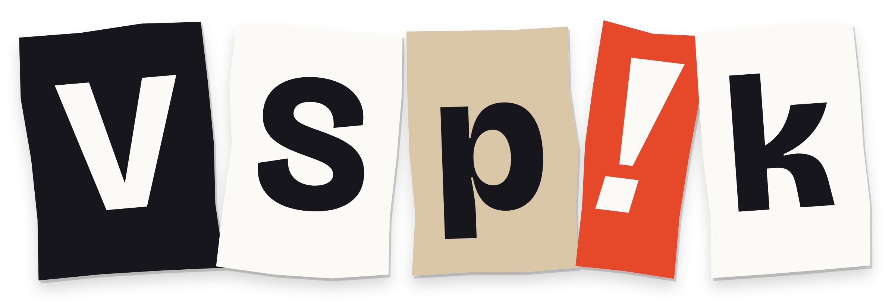

  

<b>Websites, apps, data and software. Built fast, built properly.</b>

  <a href="website/">Website</a> ·
  <a href="docs/">Docs</a> ·
  <a href="brand/">Brand</a> ·
  <a href="marketing/">Marketing</a> ·
  <a href="portfolio/">Portfolio</a> ·
  <a href="proposals/">Proposals</a> ·
  <a href="clients/">Clients</a> ·
  <a href="templates/">Templates</a>

---

VSp!k is a small studio that ships websites, web apps, e-commerce stores, mobile apps, AI features, data analytics and automation for businesses in any field, and contributes to existing software. Based in Pune, working across India.

Every project follows the [quality framework](docs/00-quality-framework.md). Nothing is shown to a client until it passes.

## Navigation

| Folder | What's inside | Start here |
|---|---|---|
| [`website/`](website/) | The studio website (static, deployed on Vercel) | [website/README.md](website/README.md) |
| [`docs/`](docs/) | How we work: quality framework, brand direction, partner programme, delivery process | [docs/README.md](docs/README.md) |
| [`brand/`](brand/) | Logo files, brand boards, colours and type | [brand/README.md](brand/README.md) |
| [`marketing/`](marketing/) | Instagram and LinkedIn posts, captions and the source files they're made from | [marketing/README.md](marketing/README.md) |
| [`portfolio/`](portfolio/) | Case studies of delivered work, and labelled concept builds | [portfolio/README.md](portfolio/README.md) |
| [`proposals/`](proposals/) | Quote and proposal template, plus sent proposals | [proposals/README.md](proposals/README.md) |
| [`clients/`](clients/) | One folder per client project, created from a template | [clients/README.md](clients/README.md) |
| [`templates/`](templates/) | Reusable project starters | [templates/README.md](templates/README.md) |

## Quick links

- **Run the website locally:** open `website/index.html`, or run `npx serve website`
- **Add a project to the site:** [website/data/projects.js](website/data/projects.js)
- **Change phone, email or partner numbers:** [website/data/site.js](website/data/site.js)
- **Start a new client:** copy [clients/_template/](clients/_template/) to `clients/<client-name>/`
- **Write a quote:** [proposals/proposal-template.md](proposals/proposal-template.md)
- **Post captions:** [marketing/captions.md](marketing/captions.md)

## Status

| Item | State |
|---|---|
| Quality framework | Done (v1.0) |
| Brand and logo | Done: cut-paper wordmark |
| Studio website | Live at [vsp-k-website.vercel.app](https://vsp-k-website.vercel.app) |
| Social posts | Reel 02 (21.5 s, original music), reel 01 (15 s), batch 01 (12 images) and batch 02 (5 images), with captions |
| Partner programme | Terms written in [docs/02-partner-programme.md](docs/02-partner-programme.md) |
| Portfolio | The Mobile Factory (live), Hotel Balaji Holiday Home (live) |

## Contact

📱 [+91 90750 18192](tel:+919075018192) · 💬 [WhatsApp](https://wa.me/919075018192) · ✉️ [thawaredhaval24@gmail.com](mailto:thawaredhaval24@gmail.com) · 🐙 [GitHub](https://github.com/Dhaval90750) · 🌐 [Website](https://vsp-k-website.vercel.app)
